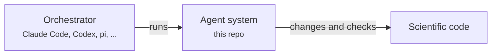
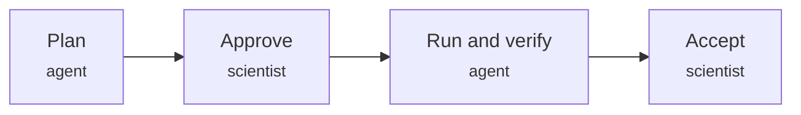

# SC26 hands-on: programmable agent systems for scientific software

## Why

Scientific production codes are long-lived infrastructure: they must keep up with new science
and new hardware, and every change must preserve numerical and scientific validity. Frontier
coding agents speed up bounded software tasks, but on their own they leave no repeatable account
of *how* a change was made, checked and accepted. This tutorial treats AI as a kind of software
we **program** rather than merely prompt. The program is a **process**: a documented, testable
workflow that can be versioned, rerun, compared across agents and improved like any research
software.

## Agent systems

An **agent system** is the program of one HPC process, written as version-controlled files:

- **stage contracts** (skills) that state what the agent may ask, change and check;
- **templates and worked examples**;
- **tools** that drive the build, the oracle and the HPC tools, in a docker image
  ([tools/README.md](tools/README.md)), inherited down the directory tree like methods of classes;
- a **provenance record** of plans, code changes, approvals and results.



*Agent systems are separate from the orchestrators that run them: the process is in the repo,
not in the tool.*

A scientist leads the process stage by stage. Every stage runs the same way:



*The team writes the process, an orchestrator carries it out, the scientist approves the plan
and accepts only verified changes, and every step is recorded.*

Each stage uses the agent pattern that fits it:

| pattern | use it when | stage here |
|---|---|---|
| interactive session | one careful change; decisions only the scientist can make | **raptorize**: precision modes and an FP64 shadow for one kernel |
| autonomous loop (author -> oracle -> reviewer) | many similar units and a cheap, exact oracle | **translate**: 13 Fortran units to C++, one per iteration |
| evolutionary search (OpenEvolve) | an open-ended objective with a trustworthy score | **optimize**: kernel rewrites for accuracy under low precision |

This repo holds two agent systems:

| system | thrust | stages | verification boundary |
|---|---|---|---|
| [`code-translation/`](code-translation/AGENTS.md) | Translation | translate | `app/tests/check.sh`: the original Fortran's output to 1e-12 |
| [`mxp-optimization/`](mxp-optimization/AGENTS.md) | Optimization | raptorize, optimize | FP64 unchanged; an audited evaluator with an equivalence guard |

## Decoupled from orchestrators

The process lives in this repo, not in any one tool, so the same workflow runs under pi, Claude
Code, Codex, OpenCode or a bespoke runtime, with any model, and can be compared fairly. Each
system is described only by `AGENTS.md` and `.agents/`; `tools/setup` links the folders Claude
Code (`.claude/`) and pi (`.pi/`) expect. Harnesses that must behave the same whoever starts them
(the translate loop, the OpenEvolve search) are the system's own code and call the model in
`config.yaml`. They run detached from the session that starts them: close it, come back later
and probe them with `status` (loop) or `evolve --status <run>` (search).
Approvals are the scientist's alone: `approve`, never the agent.

Tools are methods of classes that follow the directory tree: `tools/hpclab.py` holds `Lab`, the
root; each system subclasses it in its `dev/tools.py` and adds a stub in `dev/bin/` only for the
tools it adds or overrides, so `container` from a system runs in that system's image. A
system's `dev/` holds tools only; what it produces lives beside it, in `transformations/`
(approved, rerunnable procedures) or `experiments/` (records of open-ended work).
[tools/README.md](tools/README.md) is the contract.

## Quickstart

You need git, Docker, Python >= 3.10 and one orchestrator (Node.js too if it is
[pi](https://pi.dev)). On Windows, use Git Bash (or call any tool through Python: `python tools/setup`).

```bash
git clone --recursive <this repo> && cd SC26-Tutorial
tools/setup              # .venv, orchestrator links, docker images, both checks (--native skips docker)
$EDITOR config.yaml      # model endpoint and key for the harnesses (and pi)
```

Then open an agent in a system folder and ask for a stage.

**Translation** — Fortran to C++ with an autonomous loop:

```bash
cd code-translation && pi        # or: claude, codex, opencode
```

    > Show me the translate plan.          (review transformations/app-translate/)
    > !approve transformations/app-translate plan
    > Start the loop.                       (skill loop: asks which transformation; stops at the end of a group)
    > How is the loop doing?                (skill loop-status: report and verify)
    > !approve transformations/app-translate "Group 1"

**Optimization** — mixed precision with RAPTOR, then an evolutionary search:

```bash
cd mxp-optimization && claude    # or: pi, codex, opencode
```

    > raptorize, plan mode                  (writes the plan in experiments/<E>/<n>-raptorize/)
    > !approve <run> plan
    > raptorize, run mode                   (three checkpoints, ends with a results table)
    > !approve <run> result
    > optimize, plan mode                   (then approve, evolve <run>, accept a candidate)

`!<line>` runs a shell line in any orchestrator; in pi, skills are also `/skill:<name>`. With
`orchestrator.dev_bin_on_path: true` in `config.yaml`, every tool is on the PATH by name, without
a `dev/bin/` or `../tools/` prefix. Each system's `AGENTS.md` has the details, and
`mxp-optimization/dev/README.md` walks through its stages.

## Layout

```
config.yaml                  model endpoint of the harnesses (and of pi); orchestrator.dev_bin_on_path
tools/                       setup and what every system inherits (tools/README.md: the contract)
                             approve, container; hpclab.py (class Lab, levels, dispatch)
.agents/adapters/            Claude Code and pi settings and extension, linked by setup

code-translation/            AGENTS.md; app/ (rd2d, 13 Fortran units; tests/check.sh, the oracle)
  .agents/skills/            loop, loop-status
  dev/tools.py               class Translation(Lab); dev/bin/: oracle, readiness, build, loop, status
  dev/tools/                 loop.py (the translate loop: author -> oracle -> reviewer), index.py
  transformations/<T>/       app-translate: spec, plan, loop.toml; runs/ holds each loop's record

mxp-optimization/            AGENTS.md; app/ (Deforming Bubble, WENO5, FP64)
  .agents/skills/            raptorize, optimize (SKILL.md, templates/, examples/, scripts/)
  dev/tools.py               class Mxp(Lab); dev/bin/: new, evolve, patch, animate
  dev/tools/                 RAPTOR, OpenEvolve (submodules)
  experiments/<E>/<n>-<stage>/   one folder per stage run
```

## License

Apache License 2.0; see [LICENSE](LICENSE). Submodules under `*/dev/tools/` keep their own licenses.
